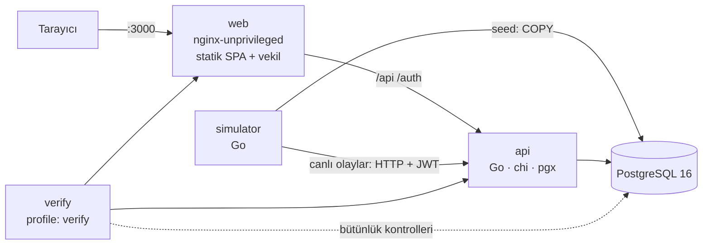

# DamarBağış — Kan Bağış Merkezi ve Kan Bankası Stok Sistemi

**Merve Sude Boztepe** · DDO Yazılım Ekibi alım projesi

Bölge kan merkezi için bağışçı kabulü, uygunluk, randevu, test ve karantina, bileşen üretimi, stok, hastane talepleri, tahsis, dağıtım, geri izleme ve stok tahmini sistemi. Backend Go, veritabanı PostgreSQL 16, ön yüz derleme adımı olmayan bir tek sayfa uygulamadır. Sistem Docker Compose ile tek komutla ayağa kalkar.

> Doğrulama rehberi: [TESTING.md](TESTING.md) · Mimari kararlar: [DECISIONS.md](DECISIONS.md) · API: `http://localhost:8080/openapi.yaml` · Elle deneme: [requests.http](requests.http)

---

## Kurulum

```bash
git clone <repo-adresi> && cd ddo-case-merve-sude-boztepe
cp .env.example .env
docker compose up --build
```

| Servis | Adres | Açıklama |
|---|---|---|
| Ön yüz | http://localhost:3000 | nginx (root olmayan); `/api`, `/auth`, `/health` isteklerini API'ye vekil eder |
| Go API | http://localhost:8080 | `GET /health`, `GET /metrics`, `GET /openapi.yaml` |
| PostgreSQL 16 | yalnızca compose ağında | host'a açılmaz |
| Simülatör | — | İlk açılışta 30.000 bağışçı + 120 günlük geçmişi seed eder, sonra canlı olay üretir |

Açılış sırası `depends_on: condition: service_healthy` ile zincirlenir: `db → api (migrasyon + demo hesapları) → simulator (seed) / web`. Seed yaklaşık 5 saniye sürer. Elle çalıştırılması gereken hiçbir adım yoktur.

| Komut | Ne yapar |
|---|---|
| `make up` | Derler, başlatır, tüm healthcheck'ler yeşil olana kadar bekler |
| `make verify` | Her `F-*`/`T-*` kimliğini uçtan uca dener, PASS/FAIL tablosu basar (≈1 dk) |
| `make reset-demo` | Hacmi silip aynı tohumla yeniden seed eder |
| `make load` | k6 yük testi |
| `make chaos` | Veritabanını durdurup API'nin toparlandığını gösterir |
| `make test` / `make test-integration` | Birim / entegrasyon testleri (`-race`) |

### Demo hesapları (parola: `Demo1234!`)

| Rol | E-posta |
|---|---|
| Yönetici | `admin@damarbagis.local` |
| Hemşire | `hemsire@damarbagis.local` |
| Laboratuvar uzmanı | `lab@damarbagis.local` · ikinci onay için `lab2@damarbagis.local` |
| Kan bankası sorumlusu | `bankasorumlusu@damarbagis.local` |
| Hastane | `hastane@damarbagis.local` · izolasyon testi için `hastane2@damarbagis.local` |
| Bağışçı | `bagisci@damarbagis.local` |

---

## Mimari özet



```
cmd/
  api/         HTTP sunucusu: migrasyon, demo hesapları, arka plan görevleri, düzgün kapanış
  simulator/   seed (30.000 bağışçı, 120 gün) + canlı olay üretimi (API üzerinden)
  verify/      make verify: uçtan uca PASS/FAIL doğrulaması
  loadgen/     k6 eşdeğeri yük aracı
internal/
  domain/      SAF iş kuralları (DB/HTTP yok) — kapsam %95–100
    eligibility/  uygunluk kuralları, zaman geçerlilikli kural defteri
    compat/       ABO/Rh uyum matrisi ve aday sıralaması
    forecast/     hareketli ortalama × gün çarpanı, FEFO kayıp, backtest (MAPE/WAPE)
    product/      durum makinesi, raf ömrü, imzalı barkod
  app/         iş akışları: transaction, kilitler, denetim kaydı, tahsis, karantina, izleme
  api/         rotalar + RBAC + OpenAPI
  httpx/       hata biçimi, JSON log, metrik, zaman aşımı, JWT, idempotans ara katmanları
  migrations/  gömülü SQL migrasyonları (şema, bütünlük tetikleyicileri, referans veri)
  secure/      AES-256-GCM (sağlık verisi)
  auth/        argon2id, JWT, refresh token
  metrics/     Prometheus metin biçimi
  sim/         deterministik seed üretici + COPY yükleyici
web/           index.html, app.js, app.css, nginx.conf
```

### Temel tasarım kararları (ayrıntı: [DECISIONS.md](DECISIONS.md))

- **İş kuralları saf fonksiyonlarda.** Uygunluk motoru bağış kaydında, randevuda, çağrı listesinde ve simülatörde ortak kullanılır; "liste uygun diyor, kayıt reddediyor" tutarsızlığı olmaz.
- **Eşzamanlılık.** Tahsis `SELECT … FOR UPDATE SKIP LOCKED` kullanır; kısmi benzersiz dizin `reservations(product_id) WHERE status='active'` çift rezervasyonu veritabanında imkânsız kılar. Aynı bağışçının eşzamanlı bağışları bağışçı satırı kilitlenerek sıraya alınır.
- **Geri alınamaz kayıt.** Ürün durum makinesi veritabanı tetikleyicisinde zorlanır. Her geçiş `product_events` tablosuna yazılır. `product_events` ve `audit_log` tablolarında UPDATE, DELETE ve TRUNCATE yasaktır. Test sonucu yalnızca çift onaylı bir talep varken güncellenebilir (bu da tetikleyiciyle denetlenir).
- **Zaman geçerlilikli kurallar.** `rule_versions` + `EXCLUDE USING gist (daterange)`. Karar, karar anındaki sürüme göre verilir ve `rule_version` alanında döner.
- **Mahremiyet.** Sağlık beyanı AES-256-GCM ile şifrelenir (AAD = bağışçı no). Erişimde gerekçe zorunludur ve okuma ile denetim kaydı aynı transaction'da yapılır. Hastaneler yalnızca bağışçı sütunu içermeyen `hospital_products` görünümünü kullanır.
- **Ön yüz seçimi:** Bağımlılıksız vanilla JS + nginx. Derleme adımı ve `npm install` yok, soğuk açılış hızlı. Ekranlar form ve tablo ağırlıklı olduğu için framework kazancı sınırlı (ADR-008). Her ekran yükleniyor / boş / hata durumlarını gösterir; mobil genişlikte kullanılabilir.

### Ortak teknik gereksinimler nasıl karşılandı

| Gereksinim | Uygulama |
|---|---|
| Parola özeti | argon2id (m=19 MiB, t=2, p=1), sabit zamanlı karşılaştırma, kullanıcı yokken de özet hesaplanır |
| Oturum | JWT HS256 access (15 dk) + refresh (7 gün, DB'de SHA-256 özeti, rotasyon, tekrar kullanımda tüm oturumlar kapanır) |
| RBAC | Her rota açık rol listesiyle korunur (`httpx.Require`); hastane verisi sorgu düzeyinde `hospital_id` ile ayrılır |
| Migrasyon | Gömülü SQL dosyaları, advisory lock, `schema_migrations` |
| Kısıtlar | FK, `UNIQUE`, `CHECK` (Hb/kilo/hacim aralıkları, test sonucu ↔ belirteç tutarlılığı, `decided_by <> requested_by`), `EXCLUDE` (kural aralıkları), kısmi benzersiz dizinler (tek açık randevu, tek aktif rezervasyon, tek bekleyen düzeltme). Para tutarı yok. |
| Eşzamanlılık | `FOR UPDATE`, `SKIP LOCKED`, benzersiz dizin; yarış testleri (`-race`) |
| İdempotans | Kritik POST'larda `Idempotency-Key`: aynı anahtar → aynı yanıt; farklı gövde → 422; işlenmekte → 409; 5xx saklanmaz |
| Denetim | `audit_log` (kim, rol, ne zaman, varlık, eski/yeni değer, gerekçe, request_id), eklemeli-yalnız |
| API | `{"error":{"code","message","details"}}`, sunucu tarafı doğrulama, keyset sayfalama (`limit`, `cursor`, `next_cursor`), anlamlı durum kodları |
| Dayanıklılık | İstek başına `context` zaman aşımı, `http.Server` zaman aşımları, düzgün kapanış (SIGTERM → açık istekler ve arka plan görevleri biter), JSON log (parola ve belirteç loglanmaz), tüm yapılandırma ortam değişkenlerinden |
| Konteyner | Çok aşamalı derleme, `distroless/static:nonroot` (≈14 MB), `read_only`, `no-new-privileges`, healthcheck'ler |

---

## Kritik sorgular ve dizinler — `EXPLAIN (ANALYZE)`

Seed edilmiş veritabanında (30.000 bağışçı, ~15.000 bağış, ~33.000 ürün, ~110.000 ürün olayı) alındı.

**1) Tahsis (uyum + FEFO + `SKIP LOCKED`)** — `products_alloc_idx (component, abo, rh_positive, expires_at) WHERE status='available'`

```
Limit (actual time=1.481..1.485 rows=2 loops=1)
  ->  LockRows (actual time=1.480..1.483 rows=2 loops=1)
        ->  Sort  Sort Key: unnest.unnest_2, p.expires_at, p.id
              ->  Hash Join  Hash Cond: ((p.abo = unnest.unnest) AND (p.rh_positive = unnest.unnest_1))
                    ->  Bitmap Heap Scan on products p (rows=1505)
                          ->  Bitmap Index Scan on products_alloc_idx (rows=2013)
                                Index Cond: ((component = 'RBC') AND (expires_at > (now() + '00:30:00')))
                    ->  Function Scan on unnest (rows=4)
Execution Time: 1.558 ms
```

**2) Bağışçının bağış geçmişi (her uygunluk kararında)** — `donations_donor_idx (donor_id, collected_at DESC)`

```
Bitmap Heap Scan on donations (actual time=0.026..0.031 rows=2 loops=1)
  ->  Bitmap Index Scan on donations_donor_idx  Index Cond: (donor_id = 1234)
Execution Time: 0.050 ms
```

**3) Süresi dolan rezervasyonlar (her 2 sn'de bir çalışan görev)** — `reservations_expiry_idx (expires_at) WHERE status='active'`

```
LockRows (actual time=0.013..0.013 rows=0 loops=1)
  ->  Index Scan using reservations_expiry_idx on reservations  Index Cond: (expires_at < now())
Execution Time: 0.024 ms
```

**4) Look-back: hasta → kök ürün (recursive)** — `transfusions_patient_idx`, `products_pkey`

```
CTE Scan on up
  ->  Recursive Union
        ->  Nested Loop
              ->  Bitmap Index Scan on transfusions_patient_idx  Index Cond: (patient_ref = 'H1-P000123')
              ->  Index Scan using products_pkey on products p
        ->  Nested Loop
              ->  WorkTable Scan on up
              ->  Index Scan using products_pkey on products par  Index Cond: (id = up_1.parent_id)
Execution Time: 0.045 ms
```

**5) Tahmin için tüketim serisi (84 gün)** — `distributions_day_idx (issued_at)`

```
HashAggregate (rows=609)
  ->  Hash Join  Hash Cond: (p.id = d.product_id)
        ->  Seq Scan on products p  Filter: (component = 'RBC')
        ->  Index Scan using distributions_day_idx on distributions d (rows=11748)
Execution Time: 13.445 ms
```

Ayrıca: `requests_queue_idx (urgency DESC, created_at) WHERE status IN ('open','partial')` tahsis kuyruğu için, `audit_action_idx (action, id DESC)` denetim kaydında keyset için, `stock_alerts_one_open` her grup için tek açık alarm garantisi için kullanılır.

---

## Yük testi

`make load` (k6, [loadtest/load.js](loadtest/load.js)) 60 saniye boyunca iki senaryoyu birlikte çalıştırır: 20 sanal kullanıcı personel okumaları yapar (stok matrisi, FEFO ürün listesi, bağışçı arama, bekleyen talepler), aynı anda saniyede 10 hastane talebi gelir (yazma + anında tahsis + idempotans anahtarı).

| Senaryo | İstek | p50 | p95 | p99 | Hata oranı | RPS |
|---|---|---|---|---|---|---|
| Personel okuma | 7.464 | 48.6 ms | 213.7 ms | 261.4 ms | %0.00 | 165.9 |
| Hastane talebi + anında tahsis (yazma) | 450 | 76.9 ms | 238.6 ms | 295.1 ms | %0.00 | 10.0 |
| Toplam | 7.914 | 49.6 ms | 215.8 ms | 263.3 ms | %0.00 | 175.9 |

*Ölçüm ortamı:* API, PostgreSQL, canlı simülatör ve yük aracı aynı 2 vCPU'luk makinede, 45 saniye. Ölçüm, k6 betiğiyle aynı karışımı üreten `go run ./cmd/loadgen` ile alındı. Tekil sorgular 0.05–13 ms aralığında (yukarıdaki planlar); p95'in ~200 ms olmasının nedeni CPU paylaşımı. Ayrı makinede API p95'inin belirgin şekilde düşmesi beklenir. k6 eşikleri: hata oranı < %1, okuma p95 < 300 ms, yazma p95 < 500 ms.

## Kaos senaryosu

`make chaos` ([scripts/chaos.sh](scripts/chaos.sh)): veritabanını durdurur → `/health` **503** döner, yazma isteği **503 `service_unavailable`** alır, API çökmez → veritabanı yeniden başlatılır → pgx havuzu yeniden bağlanır ve `/health` yaklaşık 1–3 saniyede **200** olur → yeni talep **201** → çift aktif rezervasyon olmadığı doğrulanır.

---

## Doğrulama Soruları

### 1. En zorlandığın görev hangisiydi? Hangi alternatif çözümleri düşündün ve neden eledin?

**T-3 (uyum + tahsis)** en zor görev oldu, çünkü dört gereksinim aynı transaction'da buluşuyor: uyum sırası, FEFO, eşzamanlı rezervasyon ve acil talep önceliği.

- **`SERIALIZABLE` + yeniden deneme:** Doğru sonuç verir, ama iki talep farklı ürünleri istese bile yüklemde (predicate) çakışma yüzünden birini yeniden denetir. Yük altında gecikme artar. Elendi.
- **`version` sütunuyla optimistic kilit:** Aynı ilk ürünü gören iki talepten biri her seferinde başarısız olup yeniden sorgulamak zorunda kalır. Elendi.
- **Önce stok sayacını düşürmek (grup başına sayaç satırı):** Hangi fiziksel ürünün (SKT'si farklı) rezerve edildiğini bilmek gerekiyor; sayaç FEFO'yu ifade edemez. Elendi.
- **Seçilen çözüm:** Talep satırı `FOR UPDATE` ile kilitlenir. Adaylar `unnest(grup[], rh[], sıra[])` ile join edilir ve `ORDER BY sıra, expires_at` + `FOR UPDATE SKIP LOCKED` ile seçilir. Kilitli ürün atlanır, kimse beklemez. Son savunma hattı kısmi benzersiz dizindir. Acil talepte stok yetmezse rutin rezervasyonlar aynı sıralamayla devralınır (`preempted`) ve rutin talep kuyruğa geri döner.

Acil önceliğin "kuyrukta önde olmak" mı yoksa "başkasının rezervasyonunu devralmak" mı olduğu da bir karardı. İkisi birlikte uygulandı. Rezervasyonu süresi dolan talebin otomatik kuyruğa geri girmesi sonsuz döngü riski taşıdığı için `auto_allocate=false` yapılır; yeniden tahsisi kan bankası sorumlusu yapar.

### 2. Çözümünün kırıldığı ya da yetersiz kaldığı bir senaryo (bilinen sınırlama)

- **Tahsis yerel optimum seçer.** Her talep kendi açısından en iyi ürünü alır. Örneğin O+ stoğu azken bir A+ talebi önce A+ ve A−'yi tüketir, sonra O+'ya geçer; ama aynı anda bekleyen bir O+ hastası için global olarak daha iyi bir dağıtım olabilirdi. Talepler tek tek ve aciliyet sırasıyla işlendiği için bütüncül bir eşleştirme (ör. min-cost flow) yapılmıyor.
- **Düşük hacimli gruplarda tahmin zayıf.** AB− ve B− gruplarında günlük tüketim 0–2 ünite arasında olduğu için MAPE %45'in üzerine çıkıyor (WAPE de yüksek). Model Poisson gürültüsünü ayıramıyor. Bu yüzden alarm eşiği "gün cinsinden yeterlilik" üzerinden tanımlandı; düşük hacimde kesir hataları büyük görünüyor.
- **Zaman dilimi.** Günlük gruplama ve "gün" sınırları UTC'dir. İstanbul saatiyle 00:00–03:00 arasındaki bir dağıtım önceki güne sayılır; bu, haftanın günü çarpanını hafifçe kaydırır.
- **Anahtar rotasyonu.** Şifreli verinin sürüm baytı var ama eski anahtarla şifrelenmiş kayıtları yeniden şifreleyen bir araç yazılmadı.
- **Tek API örneği varsayımı yok, ama tek veritabanı var.** Arka plan görevleri advisory lock ile tek örnekte çalışır. Veritabanı kopyası (replica) ve yük dengeleme denenmedi.

### 3. Dizinlerden ikisi: hangi sorgu için, dizinsiz/dizinli ölçüm farkı

Ölçüm yöntemi: aynı veride `BEGIN; DROP INDEX …; EXPLAIN ANALYZE …; ROLLBACK;`

| Dizin | Sorgu | Dizinli | Dizinsiz | Fark |
|---|---|---|---|---|
| `donations_donor_idx (donor_id, collected_at DESC)` | Uygunluk kararı için bağışçının geçmişi (`WHERE donor_id = $1`) — her bağış kaydında, randevuda ve çağrı listesindeki her adayda çalışır | 0.050 ms (Bitmap Index Scan) | 0.969 ms (Seq Scan, 15.000 satır) | ~19× |
| `products_alloc_idx (component, abo, rh_positive, expires_at) WHERE status='available'` | Tahsis sorgusu | 1.56 ms | 4.39 ms (planlayıcı `products_status_idx` üzerinden 14.000 satır tarar) | ~2.8× |

İlk dizinin etkisi bağışçı ve bağış sayısıyla doğrusal büyür: çağrı listesi 50 kişi için 100 aday değerlendirdiğinde dizinsiz durumda yaklaşık 100 ms'lik ek tarama demektir. İkinci dizin kısmi olduğu için yalnızca `available` ürünleri içerir. Stok büyüdükçe (geçmiş ürünler `transfused`/`expired` durumunda biriktikçe) dizin küçük kalır ve fark açılır.

### 4. Yapay zekâ kullanımı: reddedilen ya da düzeltilen bir çıktı (önce/sonra)

Kod üretiminde yapay zekâ asistanı kullanıldı; üretilen her parça testlerle doğrulandı. Testlerin yakaladığı ve düzeltilen bir örnek:

**Simülatörün determinizmi.** İlk sürüm, stokta kalıp süresi dolan ürünleri bir map üzerinde dolaşarak işliyordu:

```go
// ÖNCE
for _, byGroup := range stock {          // map[Component]map[Group][]stockItem
    for g, items := range byGroup {
        ... ds.Events = append(ds.Events, Event{... To: "expired" ...})
```

Go'da map iterasyon sırası her çalıştırmada rastgeledir. Olaylar aynı içerikte ama farklı sırada üretiliyor, bu da olay kimliklerini ve veri setinin parmak izini değiştiriyordu. "Aynı tohum → aynı veri" gereksinimini bozan bu hatayı `TestSameSeedSameData` yakaladı (`955d0ca85c04f4d3 != 05dc0fb4576e08f0`).

```go
// SONRA
for _, comp := range []compat.Component{"RBC", "PLT", "FFP"} {
    byGroup := stock[comp]
    for _, g := range compat.AllGroups() {   // sabit sıra
        items := byGroup[g]
```

Aynı düzeltme sırasında, her test sonucunda tüm ürün listesini baştan tarayan O(bağış × ürün) bir döngü de fark edildi. 30.000 bağışçılık tam seed'de bu yaklaşık 450 milyon karşılaştırma demekti. `byDonation map[int][]int` dizini eklendi; tam seed üretimi 0.5 saniyeye indi.

İkinci örnek: `'test:' || $3::text` biçiminde, `int64` parametreyi SQL'de metne çeviren bir sorgu üretilmişti. pgx bu tür çıkarımlarda `unable to encode 1 into text format` hatası veriyor. Entegrasyon testi (`TestDualApprovalForTestChange`) yakaladı; değer Go tarafında `fmt.Sprintf("test:%d", id)` ile hazırlanacak şekilde düzeltildi.

### 5. "Bağışçı uygunluk kuralları" çözümünün doğru çalıştığını nasıl kanıtladın?

İki katmanda: saf kural motoru birim testleriyle, uçtan uca davranış ise `make verify` ile.

```bash
$ go test ./internal/domain/eligibility -v -cover
--- PASS: TestEligibleHealthyFirstTimeDonor (0.00s)
--- PASS: TestWaitingPeriodMale90Days (0.00s)
--- PASS: TestWaitingPeriodFemale120Days (0.00s)
--- PASS: TestPlateletApheresis14Days (0.00s)
--- PASS: TestWholeBloodAfterPlateletUsesPlateletInterval (0.00s)
--- PASS: TestPlateletAfterWholeBlood (0.00s)
--- PASS: TestPlateletYearlyLimit (0.00s)
--- PASS: TestAgeLimits (0.00s)
--- PASS: TestAgeOnBirthdayBoundary (0.00s)
--- PASS: TestWeightAndHemoglobin (0.00s)
--- PASS: TestTemporaryDeferralAndPermanent (0.00s)
--- PASS: TestExpiredDeferralIgnored (0.00s)
--- PASS: TestTypeSpecificDeferral (0.00s)
--- PASS: TestTravelDeclaration (0.00s)
--- PASS: TestUnknownDeclarationRejected (0.00s)
--- PASS: TestMultipleReasonsNextEligibleIsLatest (0.00s)
--- PASS: TestInvalidType (0.00s)
--- PASS: TestRuleBookTimeValidity (0.00s)
--- PASS: TestDeferralEndUsesRuleAtStart (0.00s)
--- PASS: TestFutureDonationInHistoryIgnored (0.00s)
PASS
coverage: 95.9% of statements
ok  	github.com/msboztepe/damarbagis/internal/domain/eligibility	0.005s
```

Sınır değerler tam gün olarak test edilir: erkek 89. gün red / 90. gün uygun, kadın 120 gün, aferez 13/14. gün, doğum gününden bir gün önce 17 yaş. Kural sürümü değişimi için iki sürümlü bir kural defteri kullanılır: 2027-01-01 öncesi 120 gün, sonrası 100 gün. Kayıtlı ertelemenin süresi başlangıç gününün kuralına göre hesaplanır (`TestDeferralEndUsesRuleAtStart`).

```bash
$ make verify
  T-1    PASS 100. gün: K red (120g) / E uygun (90g); aferez 10.gün red / 14.gün uygun;
              seyahat → 2027-08-30'e kadar; kalıcı red tarihsiz;
              kural sürümü 2038-09-19 öncesi eski, sonrası yeni kural
```

Ayrıca simülatör, bilerek uygunsuz bağış denemelerini canlı olarak API'ye gönderir. Bunlar `422 donor_ineligible` ile reddedilir ve `eligibility.rejected` olarak denetim kaydına düşer; panodaki "Uygunsuz deneme" sayacı bu kayıtları gösterir.
